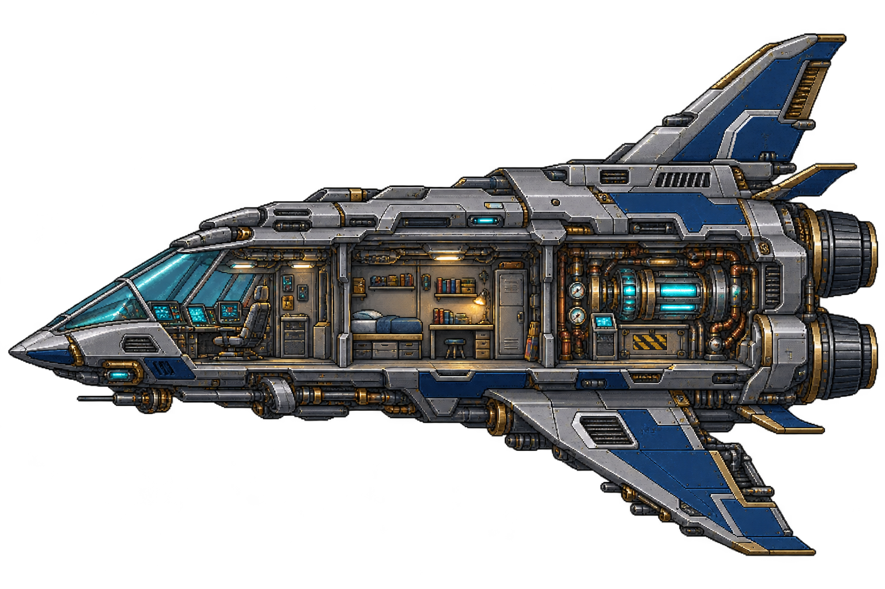

# Space-game-

Little Orbit is a playable Godot 4 study game with study timers, visual restoration, a modular ship workshop three side-view interior themes, robot equipment, and mouse-wheel ship zoom. See [the prototype guide](docs/PROTOTYPE.md) for setup, architecture, validation, and limitations.

Detailed raster artwork and its gameplay integration are documented in [PIXEL-ART-ASSETS.md](docs/PIXEL-ART-ASSETS.md).

Robots now assemble interchangeable raster heads, chassis, arms, legs and packs; see [MODULAR-ROBOT.md](docs/MODULAR-ROBOT.md).
