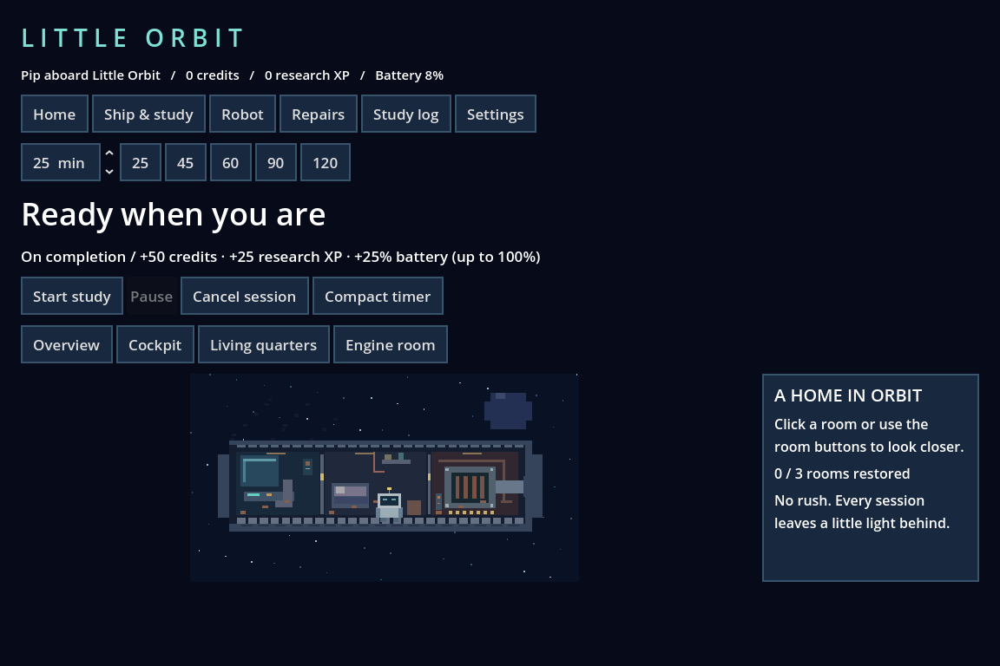

# Space-game-

Little Orbit is a playable Godot 4 study game with the Phase 1 core and Phase 2 visual restoration. See [the prototype guide](docs/PROTOTYPE.md) for setup, architecture, validation, and limitations.

