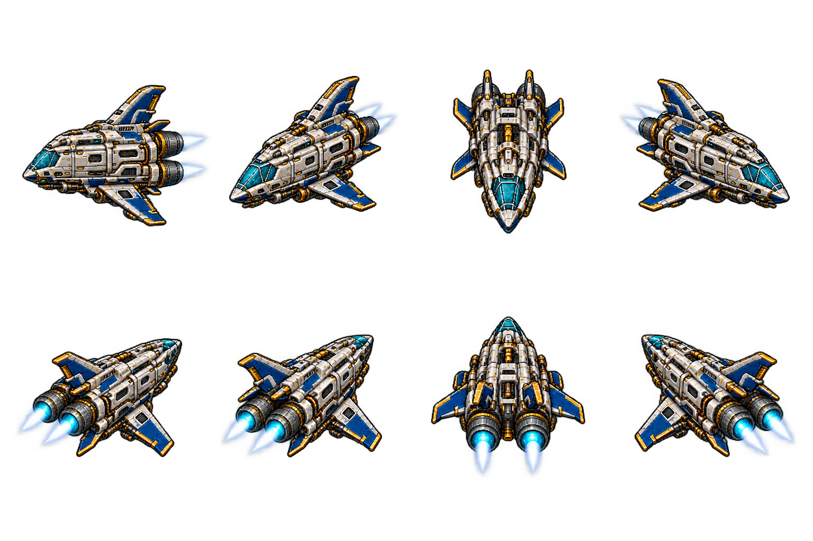

# Little Orbit

A native Godot 4.4.1 study game with detailed pixel-art ship restoration, interchangeable robot parts, connected lower-deck expansion, lab research, an immersive bridge and a task-first focus timer.

Use PLAY-GAME.cmd to run the existing project. See [the guide](docs/PROTOTYPE.md), [interactive rooms and propulsion](docs/INTERACTIVE-ROOMS.md) and [validation](docs/VALIDATION.md).

